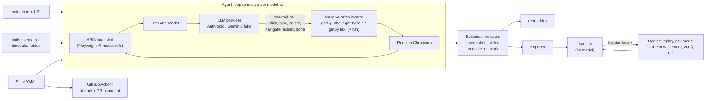
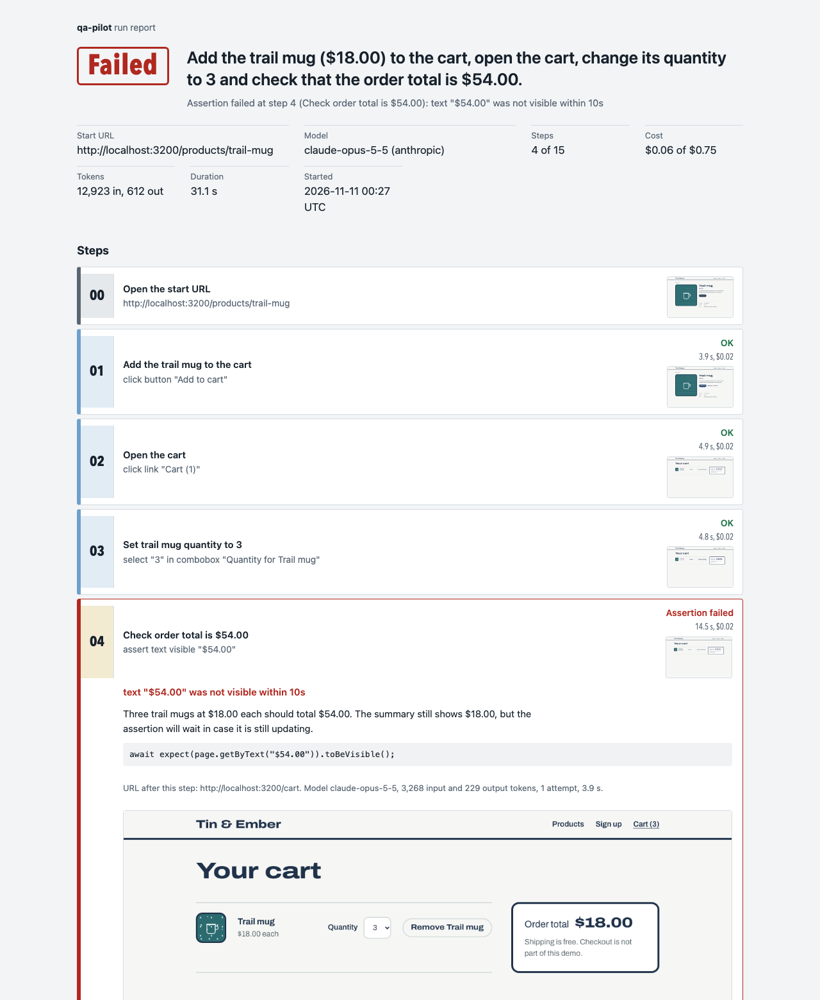
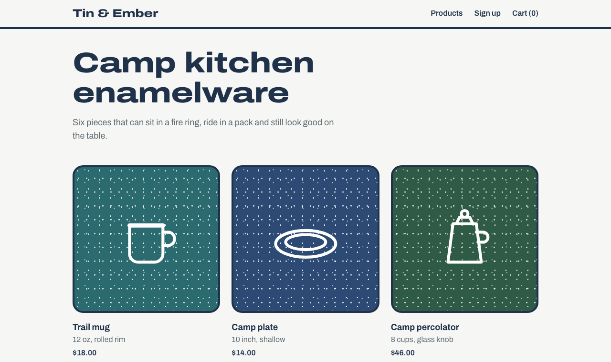

# qa-pilot

Describe a test in plain English; qa-pilot runs it in a real browser, reports pass or fail with evidence, and turns a
passing run into a Playwright test that replays with no model at all.

```bash
npx qa-pilot run "Add the trail mug to the cart, set the quantity to 3 and check the order total is \$54.00" \
  --url http://localhost:3200/products/trail-mug --export
```

> **Demo GIF placeholder.** A screen recording of `qa-pilot suite` catching the demo shop's two bugs belongs here
> (`docs/images/demo.gif`). It has not been recorded yet.

## Contents

- [What it does](#what-it-does)
- [Quick start](#quick-start)
- [How it works](#how-it-works)
- [Example report](#example-report)
- [How export to Playwright works](#how-export-to-playwright-works)
- [Self-healing](#self-healing)
- [Suites and the CLI](#suites-and-the-cli)
- [GitHub Action](#github-action)
- [Limits and cost](#limits-and-cost)
- [The demo shop](#the-demo-shop)
- [Measured results](#measured-results)
- [Design decisions](#design-decisions)
- [Known limitations](#known-limitations)
- [Development](#development)

## What it does

- **Runs an instruction.** The model reads an accessibility snapshot of the page and picks one action at a time from a
  small set: `click`, `type`, `select`, `navigate`, `assert`, `done`. Each action is resolved to a Playwright locator
  (`getByRole`, `getByLabel`, `getByText`) before it runs.
- **Records evidence.** Every run gets a folder with `run.json` (each step's intent, reasoning, locator, outcome,
  timing, tokens and cost), a screenshot per step, a video, console errors, failed network requests and a
  self-contained `report.html`.
- **Exports a deterministic test.** A passing run becomes a `.spec.ts` that `npx playwright test` runs without an API
  key.
- **Heals broken selectors.** When an exported test fails because a button was renamed, `qa-pilot heal` finds the new
  element, checks it works, and shows the change as a diff.
- **Runs in CI.** `qa-pilot suite tests.yaml` runs many instructions, and the included GitHub Action posts one results
  comment per pull request.

Providers: Anthropic (default, `claude-opus-5-5`) and Google Gemini (`gemini-3.5-flash-lite`, which has a free tier),
behind one interface, plus a scripted fake used by the tests.

## Quick start

Requires Node 24. qa-pilot is not published to npm yet, so run it from a clone:

```bash
git clone https://github.com/GillParm/qa-pilot && cd qa-pilot
npm ci
npm run build
npx playwright install chromium
cp .env.example .env            # add ANTHROPIC_API_KEY and/or GEMINI_API_KEY
```

Try it on the bundled demo shop (two bugs are on by default):

```bash
npm run build -w demo-shop && npm run start -w demo-shop     # http://localhost:3200

npx qa-pilot run "Add the trail mug to the cart and check the cart link shows 1 item" \
  --url http://localhost:3200/products/trail-mug

npx qa-pilot suite examples/demo-shop.suite.yaml             # exits 1: both bugs are caught
npx qa-pilot suite examples/demo-shop.suite.yaml --provider gemini
```

Each command prints the steps as they happen and the path to the HTML report. Exit codes: `0` pass, `1` the app failed
a test, `2` qa-pilot could not finish (a limit, bad config or a provider error).

## How it works



1. **Snapshot.** Playwright 1.65's `page.ariaSnapshotJSON({ mode: "ai" })` returns the accessibility tree with element
   refs such as `e12`. qa-pilot hoists unnamed wrappers, drops unnamed images, caps long text and option lists, and
   renders compact lines like `button "Add to cart" [ref=e13]`.
2. **Decide.** Each step is one stateless request: a fixed system prompt, the instruction, a one-line history of earlier
   steps with their outcomes, new console errors and failed requests, and the snapshot. The model must call one tool.
3. **Resolve.** The cited ref is turned into a locator: qa-pilot takes the element behind the ref and tries
   `getByLabel(name, { exact: true })` for form fields, `getByRole(role, { name, exact: true })`, a text match, then
   the bare role, keeping the first candidate that matches exactly that element and adding `.nth(i)` only when needed.
   The action then runs through that locator, so what passed in the run is exactly what the export replays.
4. **Record.** After each step: a screenshot, the console and network events from that step, tokens and cost.
5. **Stop.** On `done`, on the first failed assertion (a failed assertion is a failed test, as in any test framework), or
   on a limit. Action errors such as a missing element are fed back so the model can try another way.

## Example report

> **Example report screenshot placeholder.** An annotated tour of the report (step strips, evidence panel, video) is
> planned for `docs/images/report-tour.png`.

The real report below comes from the live run where Claude caught seeded bug 1 (the cart total does not follow the
quantity). It is a headless Playwright screenshot of
[the committed report.html](docs/live-runs/2026-11-11-claude-bugs-on/20261111-002730-order-total-follows-the-quantity/report.html).



The verdict sits next to the instruction, then the run facts, then one strip per step. The failing step opens by
default with the model's reasoning, the Playwright code that ran, and the screenshot. Screenshots are inlined so the
file can be attached anywhere; the video is linked from the same folder.

## How export to Playwright works

The export is a translation of `run.json`, not a second model call. Only steps that succeeded are written, in order:

| Recorded step                            | Exported code                                                                         |
| ---------------------------------------- | ------------------------------------------------------------------------------------- |
| start URL `http://localhost:3200/signup` | `await page.goto(new URL("/signup", BASE_URL).toString());`                           |
| `click` on button "Create account"       | `await page.getByRole("button", { name: "Create account", exact: true }).click();`    |
| `type` into a labelled field             | `await page.getByLabel("Email", { exact: true }).fill("…");`                          |
| `select` an option                       | `await page.getByLabel("Quantity for Trail mug", { exact: true }).selectOption("3");` |
| `assert` text visible                    | `await expect(page.getByText("Welcome, Ada")).toBeVisible();`                         |
| `assert` URL matches `/cart`             | `await expect(page).toHaveURL(/\/cart/);`                                             |
| `assert` input value                     | `await expect(page.getByLabel("Email", { exact: true })).toHaveValue("…");`           |

Details that make the output replayable:

- **One `test.step` per action**, titled with the step's intent ("Add the trail mug to the cart"). The healer uses
  these titles as the description of what a broken step was for.
- **Portable URLs.** Same-origin URLs are written relative to
  `const BASE_URL = process.env.QA_PILOT_BASE_URL ?? "<recorded origin>"`, so one spec runs against localhost or a
  preview deployment.
- **Unique values stay unique.** Every run gets a random token (for example `qa9d2e76`) and the model is told to put it
  in values that must be new each time, such as a sign-up email. The exporter replaces the token with a
  `const RUN = Date.now().toString(36)` placeholder, so `ada+qa9d2e76@example.com` becomes `` `ada+${RUN}@example.com` ``
  and the spec can be replayed any number of times.
- **No strict-mode surprises.** When a text assertion matched several elements during the run, the export pins
  `.first()`, the same element the run checked.
- **Provenance.** The header records the instruction, the source run and the model, plus a one-line JSON
  `// qa-pilot:` marker that tools can read.

Here is a spec exported from the live run, unedited:
[examples/specs/order-total-follows-the-quantity.spec.ts](examples/specs/order-total-follows-the-quantity.spec.ts).
Run all of them with `npx playwright test -c examples/playwright.config.ts`.

```bash
npx qa-pilot export qa-pilot-runs/<run-folder>                 # writes <name>.spec.ts into the run folder
npx qa-pilot export qa-pilot-runs/<run-folder> --out tests/e2e   # or anywhere else
npx qa-pilot run "..." --url ... --export                        # export straight after a passing run
```

Failed runs are refused unless you pass `--force`, because the steps of a failed run do not describe a working flow.

## Self-healing

```bash
DEMO_RENAME=1 npm run start -w demo-shop      # "Add to cart" is now "Add to bag"
npx qa-pilot heal examples/specs/order-total-follows-the-quantity.spec.ts --url http://localhost:3200
npx qa-pilot heal examples/specs/order-total-follows-the-quantity.spec.ts --url http://localhost:3200 --write
```

The healer parses the spec with the TypeScript compiler API, replays it step by step in Chromium, and when a `click`,
`fill` or `selectOption` no longer finds exactly one element it:

1. sends the model the step title, the action, the old locator, the error and the current snapshot, with two tools:
   `propose_locator` and `give_up`;
2. resolves the proposed ref to a locator with the same resolver the agent uses;
3. verifies it by performing the step for real, then carries on with the rest of the spec;
4. once every step passes, re-runs the healed spec from a clean browser context;
5. prints a unified diff, and only writes the file with `--write`.

Output from the live heal (Claude, renamed button):

```diff
   await test.step("Add the trail mug to the cart", async () => {
-    await page.getByRole("button", { name: "Add to cart", exact: true }).click();
+    await page.getByRole("button", { name: "Add to bag", exact: true }).click();
   });
```

Assertions are never healed. If an exported test asserts "Welcome, Ada" and that text is gone, it is far more likely to
be the bug the test exists to catch than a cosmetic change, so the healer stops and says so. The full transcript is in
[docs/live-runs/2026-11-11-heal-renamed-button](docs/live-runs/2026-11-11-heal-renamed-button).

## Suites and the CLI

```yaml
# examples/demo-shop.suite.yaml (abridged)
name: Tin & Ember demo shop
baseUrl: http://localhost:3200 # --base-url overrides it, e.g. with a preview URL
limits:
  maxSteps: 15
  maxCostUsd: 0.75 # per test
tests:
  - name: Order total follows the quantity
    path: /products/trail-mug # or url: https://...
    instruction: >-
      Add the trail mug ($18.00) to the cart, open the cart, change its quantity to 3 and check that the order total
      is $54.00.
    expect: pass # the default; use fail for a known bug you want to track
    tags: [cart]
```

| Command                                  | What it does                                                                       |
| ---------------------------------------- | ---------------------------------------------------------------------------------- |
| `qa-pilot run "<instruction>" --url <u>` | One test. `--export [file]` writes a spec after a pass.                            |
| `qa-pilot suite <file.yaml>`             | Every test in the file. `--base-url`, `--tag`, `--max-suite-cost`, `--export-dir`. |
| `qa-pilot export <run-dir>`              | Spec from a passing run. `--out`, `--name`, `--force`.                             |
| `qa-pilot heal <spec> --url <u>`         | Repair broken locators; diff only unless `--write`.                                |
| `qa-pilot github-comment`                | Used by the Action to build and post the PR comment.                               |

Shared flags: `--provider anthropic|gemini`, `--model`, `--effort low|medium|high|xhigh|max` (Anthropic),
`--max-steps`, `--max-cost`, `--action-timeout`, `--timeout`, `--retries`, `--headed`, `--no-video`. A suite writes
`summary.json`, `summary.md` and an `index.html` that links every test's report. Keys come from the environment; a
`.env` in the working directory is loaded if present and never printed.

## GitHub Action

```yaml
# .github/workflows/qa-pilot.yml in your repository
on: pull_request
permissions:
  contents: read
  pull-requests: write
jobs:
  qa-pilot:
    runs-on: ubuntu-latest
    steps:
      - uses: actions/checkout@v5
      # ...deploy a preview, or start the app, and get its URL...
      - uses: GillParm/qa-pilot@main
        with:
          suite: tests/qa-pilot.yaml
          url: ${{ steps.deploy.outputs.preview-url }}
          specs: tests/qa-pilot-specs # optional: exported specs, replayed without a model
          max-cost: "2.00" # for the whole suite
        env:
          ANTHROPIC_API_KEY: ${{ secrets.ANTHROPIC_API_KEY }}
```

What it does: installs qa-pilot from the action's checkout, runs the suite against `url`, replays the exported specs
with plain Playwright against the same URL, uploads reports, screenshots and videos as one artifact, writes the job
summary, and posts or updates a single comment on the pull request (found again on reruns by a hidden marker). The job
fails when a test does not end as its `expect` says or a spec fails (`fail-on-unexpected: false` turns that off).

Inputs: `suite`, `url`, `provider`, `model`, `max-cost`, `max-cost-per-test`, `specs`, `comment`, `image-base-url`,
`artifact-name`, `fail-on-unexpected`, `github-token`. Outputs: `suite-ok`, `specs-ok`, `artifact-url`.

- **No key, no AI suite.** Pull requests from forks do not get secrets. In that case the AI suite is skipped with a
  notice and the reason is shown in the comment; the exported specs still run because they need no key.
- **Screenshots in comments.** GitHub cannot display images stored in workflow artifacts, and there is no API to
  upload comment images from a workflow. The comment therefore names the screenshot file for each failing test and
  links the artifact. If you publish the artifact folder somewhere public (Pages, a bucket), set `image-base-url` and
  the comment embeds the screenshots instead.

This repository dogfoods the action in [.github/workflows/qa-pilot.yml](.github/workflows/qa-pilot.yml): on every pull
request it starts the demo shop with its bugs off and calls `uses: ./`. The repository has no `ANTHROPIC_API_KEY`
secret, so in CI the AI suite is skipped and the five exported specs are replayed. The regular
[CI workflow](.github/workflows/ci.yml) runs lint, typecheck, unit tests, a gitleaks scan, the integration tests and the
spec replay on every push.

## Limits and cost

| Limit              | Default | Flag / suite key                       |
| ------------------ | ------- | -------------------------------------- |
| Steps per run      | 25      | `--max-steps` / `maxSteps`             |
| Cost per run       | $1.00   | `--max-cost` / `maxCostUsd`            |
| Cost per suite     | none    | `--max-suite-cost`                     |
| Per-action timeout | 10 s    | `--action-timeout` / `actionTimeoutMs` |
| Whole-run timeout  | 300 s   | `--timeout` / `runTimeoutMs`           |
| Model call retries | 3       | `--retries`                            |
| Action retries     | 2       | (transient Playwright errors only)     |
| Consecutive errors | 3       | (then the run stops)                   |

Cost is computed from each response's token usage and a price table in
[`src/llm/pricing.ts`](packages/qa-pilot/src/llm/pricing.ts) (Claude Opus 5.5: $4 / $20 per million input / output
tokens; Gemini 3.5 Flash-Lite: $0.30 / $2.50, checked on 2026-11-10). Before each model call qa-pilot adds the most
expensive call so far to the running total and stops if that would cross the limit, so a run stops before it overspends
rather than after. Gemini runs are priced at paid rates even on the free tier, so the limit means the same thing for
every key. Retries use exponential backoff with jitter and honour `retry-after` (and Gemini's `retryDelay`).

## The demo shop



[`demo-shop/`](demo-shop) is a small Next.js 16 store (product list, product pages, cart, sign-up) with in-memory data
and two bugs planted on purpose, both on unless `DEMO_BUGS=off`:

1. **The order total ignores quantity changes.** One trail mug set to 3 still totals $18.00.
2. **Sign-up rejects valid emails that contain `+`.** `ada+test@example.com` gets "Enter a valid email address."

`DEMO_RENAME=1` renames "Add to cart" to "Add to bag" to break exported selectors for the healing demo. The switches
are read at request time, so one build serves every mode. The page never reveals whether bugs are on.

## Measured results

All numbers below come from real runs on 2026-11-11 (UTC). Raw outputs, including every `run.json`, are in
[docs/live-runs](docs/live-runs), and [docs/live-results.md](docs/live-results.md) has the details.

| Run                                         | Result                                      | Model calls | Tokens in / out | Cost    | Time       |
| ------------------------------------------- | ------------------------------------------- | ----------- | --------------- | ------- | ---------- |
| Sample suite, Claude Opus 5.5, bugs **on**  | 3 of 5 as expected; both seeded bugs caught | 22          | 70,404 / 3,385  | $0.35   | 1 min 54 s |
| Sample suite, Claude Opus 5.5, bugs **off** | 5 of 5 passed; 5 specs exported             | 24          | 76,881 / 3,786  | $0.38   | 1 min 46 s |
| Exported specs, plain Playwright, bugs off  | 5 of 5 passed                               | 0           | none            | $0      | 2.2 s      |
| Exported specs, plain Playwright, bugs on   | 3 passed, 2 failed (the two bug tests)      | 0           | none            | $0      | 13.2 s     |
| Heal of the renamed button, Claude Opus 5.5 | healed 1 locator; healed spec passed        | 1           | not recorded    | $0.0078 | n/a        |

Claude ran at the default effort (`medium`), which averaged about $0.016 per step on this shop. A development run of
the same suite with `gemini-3.5-flash-lite` (free tier, $0.04 at list price) is in the raw data too. It caught both
bugs, but in two tests it kept re-asserting text it had already verified and used all 15 steps (one of them stopped at
the limit), which is what led to the repeated-assertion guard described below.

## Design decisions

The owner of this project delegated every decision. These are the ones that shaped it, and why.

- **Stateless steps instead of one long conversation.** Each step sends the instruction, a short history and the
  current snapshot. Cost per step stays flat instead of growing with the run, the same code works for every provider,
  and there are no thinking blocks to carry between turns. The trade-off is that the model only sees one-line summaries
  of earlier steps, not earlier snapshots.
- **Refs in, locators out.** The model never writes selectors; it cites a ref from the snapshot, and qa-pilot builds
  the locator and checks it points at that exact element. That is what makes export a pure translation and keeps the
  exported code to readable `getByRole`/`getByLabel`/`getByText` calls.
- **Tool use with `tool_choice: auto`.** Claude Opus 5.5 rejects forced tool choice, so the request uses `auto`, strict
  tool schemas and disabled parallel calls, and a reply without a tool call gets one nudge. Thinking cannot be turned
  off on Opus 5.5; depth is set with `output_config.effort`. Refusals become a clear non-retryable error, and the
  server-side `fallbacks: "default"` option is enabled so a policy decline can be retried on Anthropic's fallback
  model.
- **A failed assertion ends the run.** Letting the model "correct" an expectation after seeing the page would let it
  explain bugs away. The prompt says so too: the correct result when the app is wrong is a failed test.
- **Guards against unproductive replies.** `done(pass)` is refused until at least one assertion has passed, and an
  assertion that already passed is refused with a pointer to `done`. The second guard came from the Gemini dev run.
- **Wait for a quiet DOM, not just load events.** Client-side navigation in Next.js fires no load event, so after each
  action qa-pilot also waits until the DOM has been quiet for 400 ms (capped). Without it, the first integration run
  snapshotted the cart before it rendered.
- **A run token instead of a "unique" flag.** Values that must be new per run carry a random token the exporter can
  find and replace, which also covers later assertions that mention the same email.
- **Heal replays in-process.** The healer needs the live page at the moment a step breaks, so it parses the spec with
  the TypeScript compiler API and replays it with the same executor, rather than driving `playwright test` and reading
  its output.
- **TypeScript 6, not 7.** typescript-eslint does not support TypeScript 7 yet, and the healer needs the compiler's
  JavaScript API.
- **Request-time demo switches.** The demo shop reads `DEMO_BUGS` and `DEMO_RENAME` inside `await connection()` under
  `<Suspense>`, so one build can run with bugs on, off and renamed side by side, which the integration tests rely on.

## Known limitations

- **Action set.** No hover, drag and drop, file upload, keyboard shortcuts, multiple tabs or dialogs. Forms need a
  visible submit control, because there is no "press Enter".
- **Assertions are positive.** There is no "text is not visible" kind, so an instruction like "check that no welcome
  message appears" cannot be verified directly.
- **Text assertions are substring matches** (Playwright's `getByText`), so a short expectation can be satisfied by the
  wrong part of the page. The demo shop's cart shows unit prices as "$18.00 each" and only one computed total for this
  reason; on your app, phrase instructions so the expected text is distinctive.
- **Exported locators use exact accessible names.** That is readable and strict, but names that embed state, such as
  `link "Cart (1)"`, make a spec depend on that state. Heal can repair them, but it is better to edit such steps by hand.
- **Model runs are not deterministic.** Two runs of the same instruction can take different paths. The exported spec is
  the deterministic artifact; treat the model run as the way to write it.
- **Large pages are truncated** at 400 snapshot lines, and iframes are only as visible as Playwright's AI snapshot makes
  them.
- **Healing** covers interactions only, needs the spec in the exporter's style (it reports unsupported lines), and can
  still pick the wrong element if the model does. Read the diff before using `--write`.
- **Costs are list-price estimates** from token usage. Real bills can differ (fallback models, prompt caching, free
  tiers).
- **Not verified live in GitHub Actions:** the AI suite inside the Action, because this repository has no API key
  secret. The Action's skip path, spec replay, artifact upload and PR comment are exercised by the workflow in this
  repository. Embedding screenshots via `image-base-url` is unit-tested but has not been tried against a real host.
- **Not on npm.** The CLI runs from a clone and the Action builds from source.

## Development

```bash
npm ci && npx playwright install chromium
npm run lint && npm run format:check && npm run typecheck
npm test                       # unit tests: offline, fake provider, real Chromium
npm run build -w demo-shop
npm run test:integration       # starts the demo shop three times (ports 3201-3203)
npm run test:live              # calls a real model; needs a key; QA_PILOT_LIVE_PROVIDER=gemini to switch
```

Layout: [`packages/qa-pilot`](packages/qa-pilot) (library and CLI), [`demo-shop`](demo-shop) (Next.js target app),
[`examples`](examples) (sample suite and exported specs), [`action.yml`](action.yml) (the Action) and
[`docs`](docs) ([plan](docs/plan.md), [live results](docs/live-results.md), raw run data).

## License

MIT. See [LICENSE](LICENSE).
